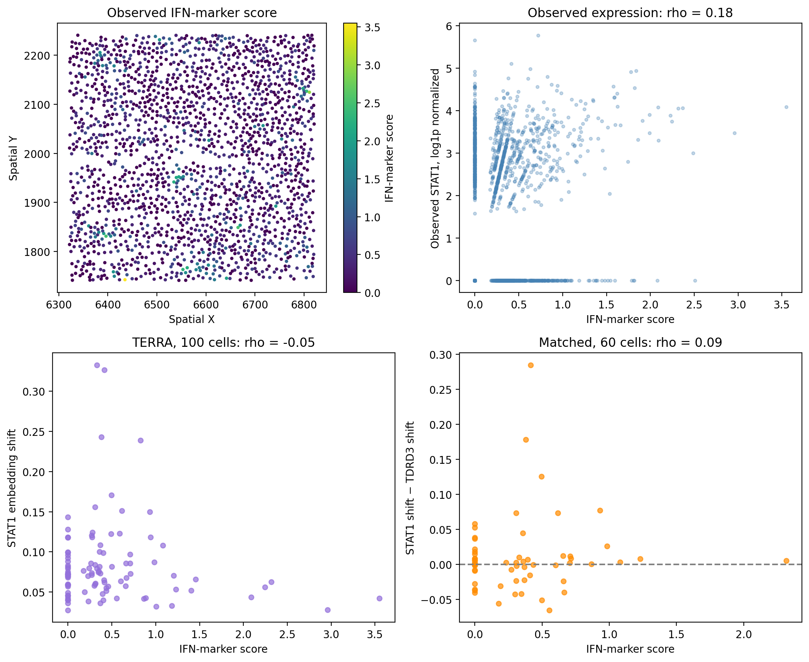

# Exploring STAT1 in Spatial Melanoma Data with TERRA

This hands-on project explores STAT1 and interferon-response markers in one public spatial transcriptomics dataset. It uses the pretrained [TERRA-96M](https://huggingface.co/lotfollahi-lab/TERRA-96M) model to examine how removing the STAT1 input token changes cell embeddings. No model fine-tuning was performed.

## Questions

- Is observed STAT1 expression associated with an interferon-marker score?
- Is that score associated with TERRA's sensitivity to STAT1 token removal?

## Data and approach

The analysis uses one [10x Genomics Xenium melanoma tissue section](https://www.10xgenomics.com/datasets/xenium-prime-ffpe-human-skin). A central region of 1,881 cells was retained after filtering, with surrounding cells included as spatial context.

1. Selected 100 central cells with detectable STAT1 and removed the STAT1 token from each cell's model input.
2. Measured the L2 distance between the original and edited spatial cell embeddings.
3. Compared STAT1 token removal with TDRD3 token removal in 60 cells where both tokens were present. TDRD3 was selected based on token-rank similarity.
4. Calculated an observed interferon-marker score from nine available genes and compared it with STAT1 expression and embedding shifts using Spearman correlation.

## Results

| Comparison | Cells | Spearman rho |
| --- | ---: | ---: |
| Observed STAT1 expression vs marker score | 1,881 | 0.178 |
| STAT1 embedding shift vs marker score | 100 | -0.053 |
| STAT1 minus TDRD3 shift vs marker score | 60 | 0.087 |

Observed STAT1 expression showed a weak positive association with the marker score. The association between the score and STAT1 embedding shift was close to zero. In the matched comparison, STAT1 produced a larger shift than TDRD3 in 35 of 60 cells.



See also the [100-cell spatial analysis](results/stat1_100_cells.png) and [paired STAT1–TDRD3 comparison](results/stat1_vs_reference.png).

## Interpretation

This is an exploratory analysis of one tissue section. Removing a model input token is not an experimental knockout, and an embedding shift is not a direct prediction of a biological response. TDRD3 is a comparison gene, not a validated negative control. The marker score is sparse: 810 of 1,881 cells had a score of zero. Cell type, spatial context and technical factors may affect the associations.

## Run the notebook

Open [STAT1_TERRA.ipynb](STAT1_TERRA.ipynb) in Google Colab, choose a GPU runtime and run the cells in order. The notebook installs `terra-st==0.1.13` and downloads the public dataset and a pinned model checkpoint. The original run used a Tesla T4 GPU; a fresh end-to-end rerun has not been independently verified.

The dataset and model weights are downloaded separately and are not included in this repository. Refer to the [10x data license](https://www.10xgenomics.com/datasets/xenium-prime-ffpe-human-skin) and [TERRA model card](https://huggingface.co/lotfollahi-lab/TERRA-96M) for reuse terms.

To check the saved tables without a GPU:

```bash
python -m pip install numpy pandas scipy
python scripts/verify_results.py
```

This checks consistency of saved results; it does not rerun TERRA or validate biological predictions. Figures and tables are in `results/`.

## Reference

[Multi-scale modeling of human tissues from spatial transcriptomics with TERRA](https://doi.org/10.64898/2026.07.29.741565), bioRxiv preprint.
